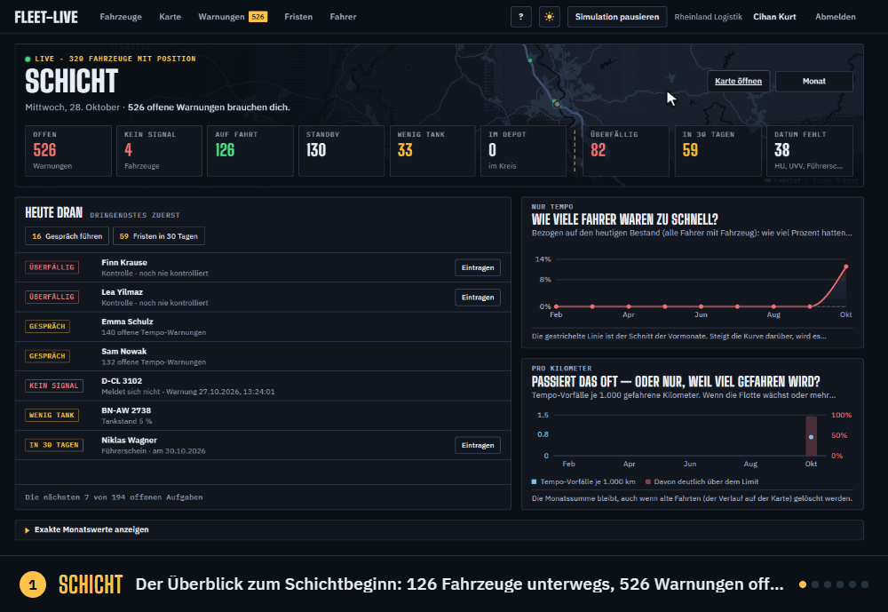
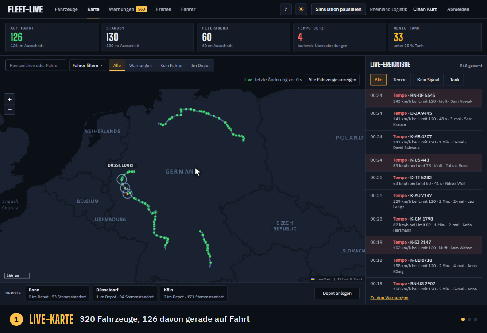
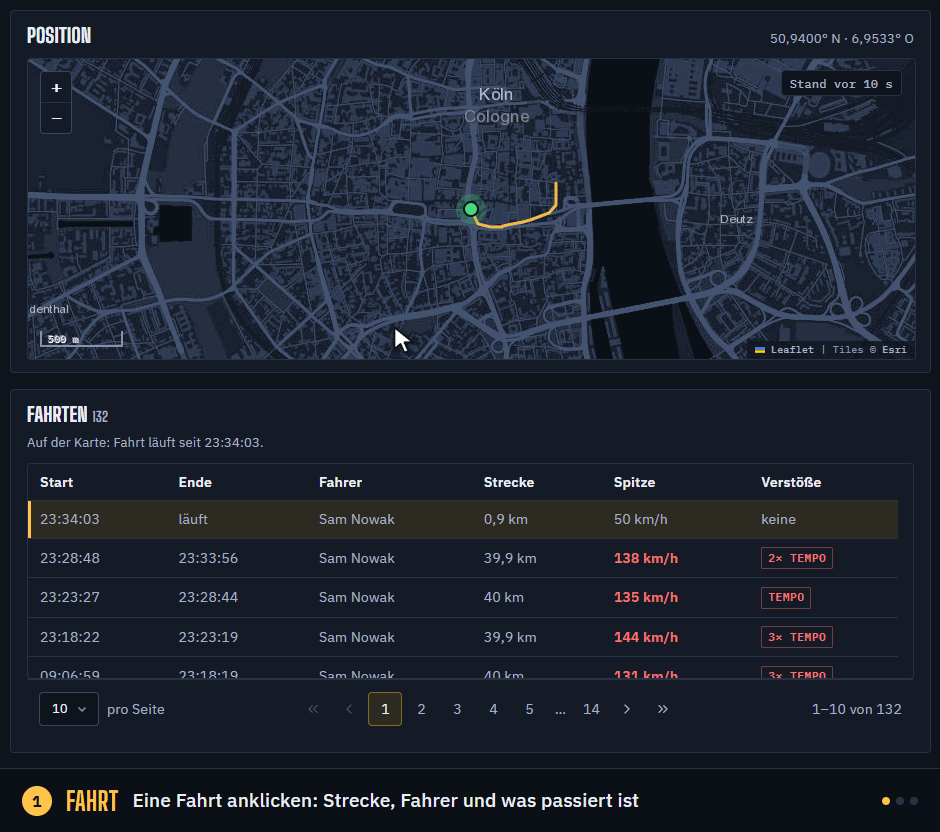

# fleet-live 🚚

Eine Leitstelle für Fuhrparks. Disponenten sehen auf einen Blick, wo jedes Fahrzeug gerade ist, wer zu schnell fährt, welche Prüffristen ablaufen und was heute zu tun ist.

fleet-live ist ein Ein-Personen-Projekt, gebaut mit KI-Unterstützung: Datenmodell, API, Oberfläche, Simulator und Tests. Die App läuft lokal. Die GPS-Daten kommen aus einem eingebauten Simulator, damit die Demo ohne Hardware und ohne Cloud läuft.

<p align="center">
  
</p>
<p align="center"><sub>Ein Durchgang ohne Schnitt: Schicht → Live-Karte → Tempo-Warnung → Fahrzeug → Fahrt nachspielen → helles Design.</sub></p>

**TypeScript** · React 19 · Vite · Leaflet · Express 5 · SQLite · Zod · Server-Sent Events · über 850 automatisierte Tests

## Was daran schwierig war

**Live-Daten, sauber nach Firma getrennt.** Positionen kommen per Server-Sent Events. Jede Verbindung meldet, welche Fahrzeuge sie gerade zeigt, und bekommt nur deren Positionen, und nur aus der eigenen Firma. Endet eine Sitzung oder wechselt jemand die Firma, schließt der Server auch die Live-Verbindung.

**Punkte, die fahren statt springen.** Ein Gerät meldet sich alle paar Sekunden, unregelmäßig und mit Verspätung. Die Karte spielt die Meldungen auf der Uhr des Geräts nach, mit einem kleinen Puffer wie ein Video, und lässt den Punkt die Straße entlang gleiten. Vorhergesagt wird nichts: Der Punkt steht nie vor der letzten bekannten Position.

**Eine Fahrt ist eine Zeile.** Jede Meldung hängt ihr Stück Straße als kodierte Polyline an die Fahrt an, ohne den bisherigen Weg zu lesen. Beim Abschluss vereinfacht Ramer-Douglas-Peucker die Linie auf 12 m. Eine 290-km-Fahrt aus der Demo-Datenbank belegt knapp 2 KB. Wie weit man zurückschauen kann, hängt so an der Fahrt, nicht daran, wie oft ein Gerät funkt.

**Warnungen, die nicht nerven.** Eine Tempo-Warnung öffnet erst nach 8 Sekunden am Stück über dem Limit. Weitere Überschreitungen derselben Fahrt zählen zur selben Warnung, statt hundert neue zu erzeugen. Sie nennt die schlimmste Stelle: 70 km/h bei Limit 50 wiegt schwerer als 121 bei 120. Wenig Tank und Kein Signal schließen sich von selbst, sobald der Tank wieder über 15 % steht oder das Fahrzeug wieder meldet.

**Mehrere Firmen, echte Anmeldung.** Eine Person kann in mehreren Firmen sein, mit einer Rolle je Firma: Dispatcher pflegen, Viewer lesen. Fahrzeuge einer fremden Firma antworten mit 404, als gäbe es sie nicht. Passwörter mit scrypt, Sitzung im HttpOnly-Cookie, Zwei-Faktor per Authenticator-App, Anmeldung über Google, Microsoft oder den Login der eigenen Firma (OIDC).

## Live-Karte

Alle Fahrzeuge der Firma auf einer Karte, jeder Punkt fährt auf seiner Straße. Ein Klick zeigt, wer fährt, wie schnell und wann die letzte Meldung kam, und die Karte fährt mit.

<p align="center">
  
</p>

## Fahrt nachspielen

Eine Fahrt anklicken: Die Karte zeigt nur diese Fahrt, rot sind genau die Stücke, auf denen das Fahrzeug zu schnell war. Daneben stehen Fahrer, Strecke, Höchsttempo und das Limit an der Stelle. Abspielen fährt die Fahrt nach, und die offene Tempo-Warnung lässt sich gleich dort erledigen.

<p align="center">
  
</p>

## Schichtüberblick

Der erste Blick zum Schichtbeginn: wie viele Fahrzeuge fahren, was offen ist, welche Fristen ablaufen, und „Heute dran“ mit dem, was jetzt zu tun ist. Jede Zahl öffnet die Liste mit genau diesen Zeilen.


Außerdem: eine Warnungs-Inbox, Fahrzeug- und Fahrerlisten, Fristen für HU, UVV und Führerschein, der Import von Fahrzeugen und Fahrern aus Excel oder CSV mit Prüfung jeder Zeile vor dem Schreiben, und CSV-Export. [Alle Funktionen mit Bildern](docs/funktionen.md)

## In fünf Minuten starten

Node.js 24 und npm 11.

```bash
npm ci
npm run db:seed
npm run dev
```

Dann `http://localhost:5173` öffnen und anmelden:

- Dispatcher: `cihan@example.com`
- Viewer: `viewer@example.com`
- Passwort für beide: `development-only-password`

`npm run verify` prüft Typen, beide Testsuiten, Lint und den Production-Build.

## Mehr

- [Funktionen](docs/funktionen.md): alles, was die App heute kann
- [Technik](docs/technik.md): Aufbau, Datenmodell, Live-Daten, Fahrten, Warnungen, Grenzen
- [API](docs/api.md): alle Endpunkte, mit Beispiel
- [Lokale Entwicklung](docs/entwicklung.md): Skripte, Umgebungsvariablen, Login über Google, Microsoft und Firmen-IdP
- [Sicherheit](SECURITY.md): Sicherheitsmodell und offene Punkte
- [Datenschutz-Infoblatt](docs/datenschutz-infoblatt.md): welche Daten über Fahrer gespeichert werden, wie lange und wer sie sieht (Entwurf)
