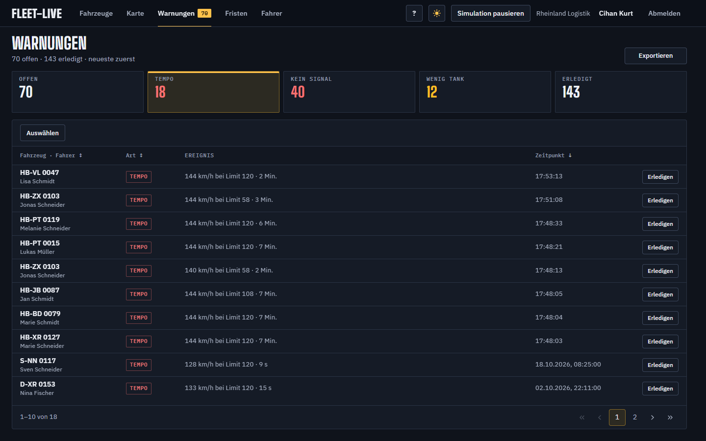
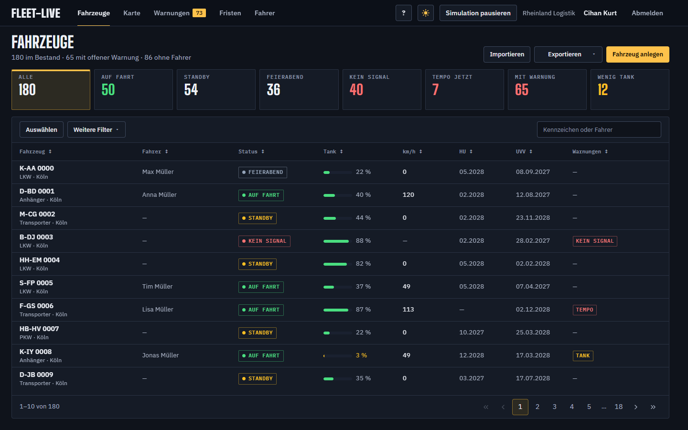
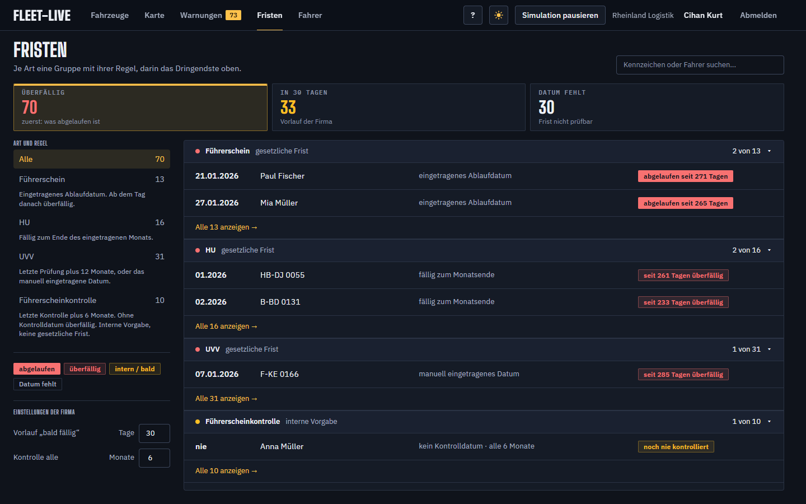
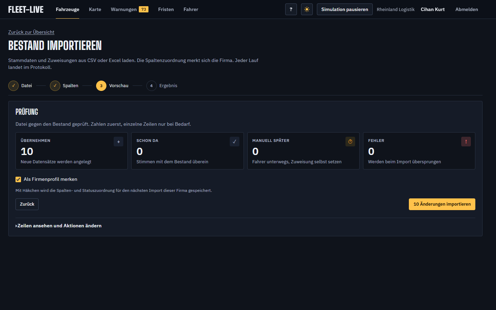

# Funktionen

Zurück zur [README](../README.md).

## Seiten

### Warnungs-Inbox

Alle Warnungen an einem Ort: zu schnell, wenig Tank, kein Signal. Einzeln erledigen oder mehrere auf einmal.

### Fahrzeugliste

Die Kacheln oben sind die Filter. Suche, Sortierung und Seiten laufen auf dem Server, die Liste lädt nur, was zu sehen ist.

### Fristen

HU, UVV, Führerschein und Führerscheinkontrolle, nach Art gruppiert. Die Firma stellt ein, wie früh gewarnt wird.

### Stammdatenimport

Fahrzeuge und Fahrer aus Excel oder CSV. Vor dem Schreiben prüft eine Vorschau jede Zeile: neu anlegen, aktualisieren, schon da oder Fehler.

## Was die App heute kann

* Geschwindigkeitswarnung, solange ein Fahrzeug über dem Streckenlimit liegt. Eine Warnung je Fahrt: weitere Überschreitungen derselben Fahrt zählen dazu (Anzahl, Höchsttempo, Summe der Dauer). Beendete, nicht erledigte Tempo-Warnungen werden nach 7 Tagen Verlauf
* Niedriger Tankstand (unter 15 %) ist eine Warnung, die von selbst verschwindet, sobald getankt ist
* Kein Signal, wenn ein Fahrzeug verstummt oder offline gemeldet ist. Die Warnung schließt sich selbst, sobald es wieder meldet
* Warnungen offen oder erledigt, Filter nach Geschwindigkeit, Tank, Kein Signal. Erledigte Warnungen werden nach 90 Tagen gelöscht, die Monatssummen der Schicht-Diagramme bleiben
* Kurze Tipps auf Schicht, Fristen, Fahrzeuge, Warnungen, Fahrer und Karte (einmal je Person, über „?“ wieder abrufbar)
* Fahrer-Filter auf der Karte: einzelne Fahrer wählen oder alle Treffer einer Suche filtern
* Schichtüberblick auf der Startseite, offene Warnungen in der Navigation
* Flottenkarte mit Dichtezellen und Kennzeichen-Sprung, Fahrspur am Fahrzeug, Fahrer, Firmen-Login
* Fahrtarchiv am Fahrzeug: alte Fahrten durchblättern. Eine Fahrt anklicken zeigt nur sie auf der Karte, Tempo-Verstöße und Funklöcher an ihrer Stelle, Fahrer, Höchsttempo und Limit; Abspielen fährt sie nach, die Tempo-Warnung lässt sich dort erledigen
* Fahrzeuge, Fahrer, Freigaben und aktuelle Besatzung aus CSV oder Excel (`/vehicles/import`)
* Letzte Spaltenzuordnung bleibt pro Firma gespeichert, jeder Import steht im Log
* Hof-Stammdaten am Fahrzeug: VIN, Typ, HU- und UVV-Fälligkeit, Depot, Kostenstelle
* Fristen: HU, UVV, Führerschein-Ablauf und Führerscheinkontrolle. Die Startseite zählt überfällig, in 30 Tagen und leere Felder. Die Liste unter Fristen zeigt dieselben Zeilen. Eine fehlende Kontrolle ist überfällig. Keine neuen Inbox-Typen.
* Import-Spalte Depot (auch Standort) setzt den Stammstandort und eine Startposition am Hof, mit kleinem Versatz. Ohne Angabe gilt das Standarddepot, ohne Depot eine Fallback-Koordinate. Lat/Lng in der Datei sind ein Sonderfall und haben Vorrang. Ein zweiter Import verschiebt vorhandene Positionen nicht.
* Fahrer mit Telefon, Umbenennen ohne Fahrzeugformular, Liste mit auffälligen Fahrern zuerst
* Depots als benannte Kreise auf der Flottenkarte, Stammstandort am Fahrzeug, Filter „Im Depot“
* CSV der Firma: Fahrzeuge, Warnungen und Fahrten. Nur der Dispatcher. Die Datei nimmt den ganzen Bestand, nicht die aktuelle Seite
* Monat auf der Schicht als CSV: Kilometer, in dem Monat angelegte Warnungen (offen und erledigt) und Verbrauch. 25 Liter je 100 km aus der gefahrenen Strecke. Der Tankzeiger bleibt die Messung
* Firma registrieren, E-Mail bestätigen, Passwort zurücksetzen und ändern
* Dispatcher und Viewer einladen, zwischen eigenen Firmen wechseln
* Zwei-Faktor (Authenticator-App) und Anmeldung über Google, Microsoft oder einen Firmen-OIDC
* Leere Firma fragt einmal, ob Stammdaten importiert werden sollen

## Als Nächstes

* Tempo-Warnungen älterer Fahrten, die noch einzeln in der Datenbank stehen, je Fahrt zusammenführen
* Prüfung von Firmen-SSO und Einladungen durch eine zweite Stelle
* Feierabend als Kachel auf der Schicht
