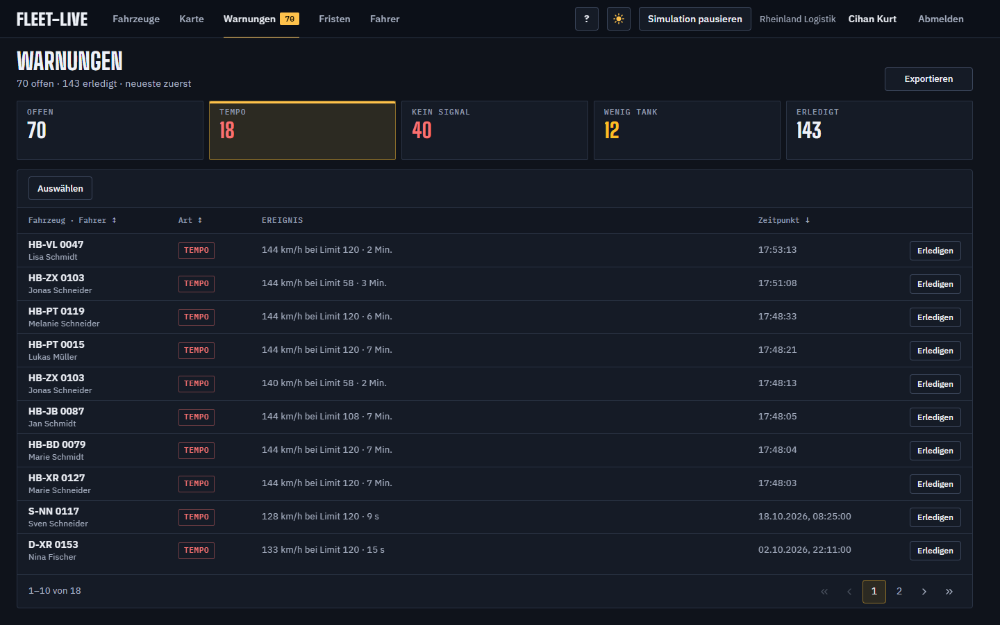
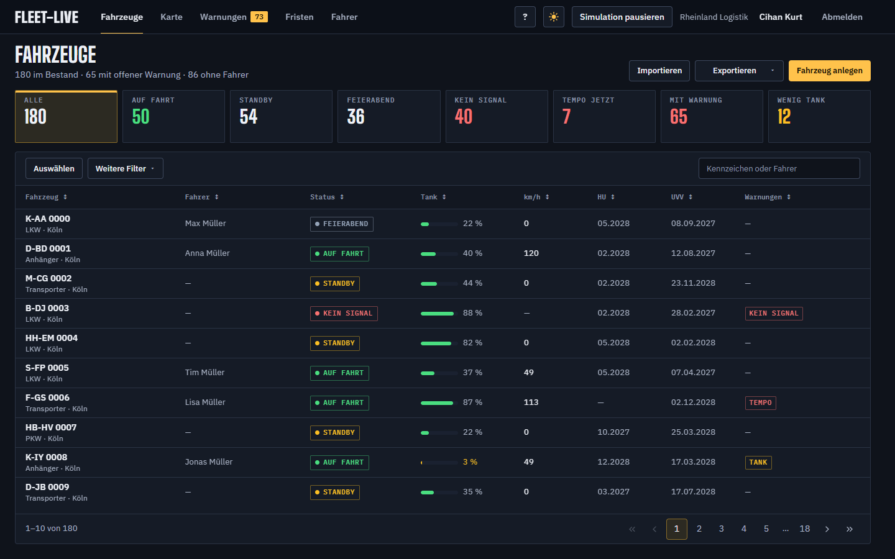
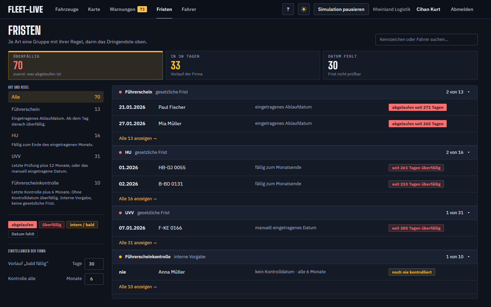
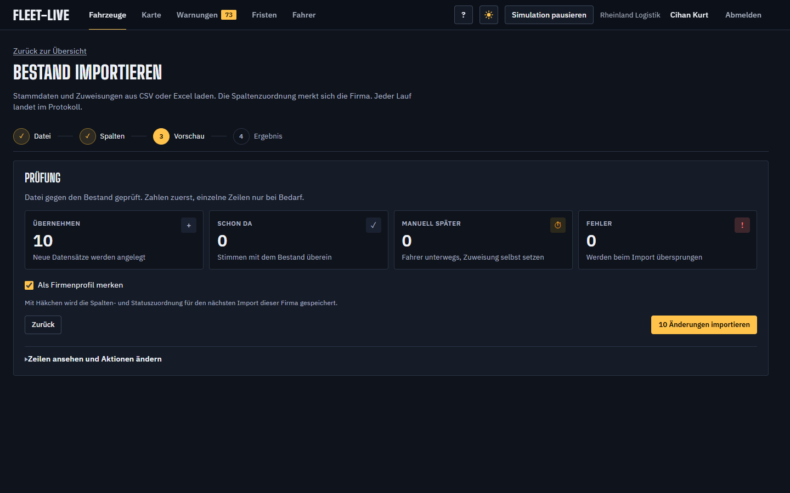

# Funktionen

Zurück zur [README](../README.md).

## Seiten

### Warnungs-Inbox

Alle Warnungen an einem Ort: zu schnell, wenig Tank, kein Signal. Einzeln erledigen oder mehrere auf einmal.

### Fahrzeugliste

Die Kacheln oben sind die Filter. Suche, Sortierung und Seiten laufen auf dem Server, die Liste lädt nur, was zu sehen ist.

### Fristen

HU, UVV, Führerschein und Führerscheinkontrolle, nach Art gruppiert. Die Firma stellt ein, wie früh gewarnt wird.

### Stammdatenimport

Fahrzeuge und Fahrer aus Excel oder CSV. Vor dem Schreiben prüft eine Vorschau jede Zeile: neu anlegen, aktualisieren, schon da oder Fehler.

## Was die App heute kann

* Geschwindigkeitswarnung, solange ein Fahrzeug deutlich (ab 10 km/h) über dem Streckenlimit liegt; knapp darüber färbt nur die Live-Anzeige orange. Die Streckenklassen der Simulation hängen am Fahrzeugtyp (LKW außerorts niedriger und abgeregelt) und sind Stufen, keine Rechtsangabe. Eine Warnung je Fahrt: weitere Überschreitungen derselben Fahrt zählen dazu (Anzahl, schlimmste Stelle, Summe der Dauer). Beendete, nicht erledigte Tempo-Warnungen werden nach 7 Tagen Verlauf
* „Gespräch geführt“ auf der Fahrerseite erledigt alle offenen Tempo-Warnungen des Fahrers auf einmal, mit Vermerk und freiwilliger Notiz
* Ein Klick auf eine Warnung öffnet das Fahrzeug mit der Fahrt, auf der sie entstand
* Niedriger Tankstand (unter 15 %) ist eine Warnung, die von selbst verschwindet, sobald getankt ist
* Kein Signal, wenn ein Fahrzeug verstummt oder offline gemeldet ist. Die Warnung schließt sich selbst, sobald es wieder meldet. Hinweise am Fahrzeug nennen die Dauer und die Telefonnummer des Fahrers; ein abgestelltes Fahrzeug sagt „Zündung aus seit …“ statt einer alten Meldezeit
* Warnungen offen oder erledigt, Filter nach Geschwindigkeit, Tank, Kein Signal. Erledigte Warnungen werden nach der Aufbewahrung der Firma gelöscht (Standard 90 Tage), die Monatssummen der Schicht-Diagramme bleiben
* Kurze Tipps auf Schicht, Fristen, Fahrzeuge, Warnungen, Fahrer und Karte (einmal je Person, über „?“ wieder abrufbar)
* Fahrer-Filter auf der Karte: einzelne Fahrer wählen oder alle Treffer einer Suche filtern
* Schichtüberblick auf der Startseite, offene Warnungen in der Navigation
* Flottenkarte mit Dichtezellen und Kennzeichen-Sprung, Fahrspur am Fahrzeug, Fahrer, Firmen-Login
* Fahrtarchiv am Fahrzeug: alte Fahrten durchblättern. Eine Fahrt anklicken zeigt nur sie auf der Karte, Tempo-Verstöße und Funklöcher an ihrer Stelle, Fahrer, Höchsttempo und Limit; Abspielen fährt sie nach, die Tempo-Warnung lässt sich dort erledigen
* Fahrzeuge, Fahrer, Freigaben und aktuelle Besatzung aus CSV oder Excel (`/vehicles/import`)
* Letzte Spaltenzuordnung bleibt pro Firma gespeichert, jeder Import steht im Log
* Hof-Stammdaten am Fahrzeug: VIN, Typ, HU- und UVV-Fälligkeit (HU als Plakette), Depot, Kostenstelle
* Fahrzeugliste: abgelaufene oder heute fällige HU/UVV gelb mit Punkt, bald fällige mit Ring, Hinweis „HU abgelaufen“ / „UVV heute“, Filter „Frist abgelaufen“ und „Frist bald fällig“ (dieselbe Regel wie unter Fristen)
* Kachel „Ausfall“ auf Schicht, Fahrzeugen und Karte: Fahrzeuge, die heute nicht fahren (Werkstatt, nicht fahrbereit, außer Dienst)
* Kilometerstand unter „Jetzt“ mit Herkunft: ein LKW meldet den Tachostand selbst (in der Demo die Simulation, wie über die FMS-Schnittstelle), Transporter und PKW sind GPS-Boxen: einmal eingetragen, danach rechnet die App jede gemeldete Strecke dazu („≈“). Korrigieren nur bei GPS-Boxen, mit Herkunft; der Verlauf zeigt jeden Wechsel. Beim Fertigmelden lässt sich der Stand laut Werkstattrechnung übernehmen. Import und Fahrzeug-Export kennen die Spalte; ein Tachostand vom Gerät wird nicht überschrieben
* Fristen: HU, UVV, Führerschein-Ablauf und Führerscheinkontrolle. Die Startseite zählt überfällig, in 30 Tagen und leere Felder. Die Liste unter Fristen zeigt dieselben Zeilen, jede mit ihrem nächsten Schritt (Werkstatt-Termin, neues Ablaufdatum, Kontrolle eintragen). Eine fehlende Kontrolle ist überfällig; eine Kontrolle nach Ablauf des Führerscheins zählt nicht. Keine neuen Inbox-Typen.
* Abgelaufener Führerschein: der Fahrer lässt sich keinem Fahrzeug zuweisen und kein Fahrzeug hinbringen; ist er schon eingeteilt, steht das ganz oben in „Heute dran“ und auf der Fahrerseite mit „Abnehmen“
* Schaden melden: was passiert ist, Schwere, fahrbereit ja/nein, wann (Tag und Uhrzeit), der Fahrer zu dem Zeitpunkt, wo (Punkt auf der Karte, vorbelegt mit der letzten Meldung) und bis zu 3 Fotos (im Browser verkleinert), auf Wunsch gleich mit Werkstatt-Termin. Nicht fahrbereit heißt: kein Fahrer, bis der Schaden behoben ist; eine Panne unterwegs hält das Fahrzeug an und beendet die Fahrt. Ein Werkstatt-Termin nimmt die gemeldeten Schäden auf und setzt sie beim Fertigmelden auf behoben; kleine Schäden lassen sich ohne Werkstatt erledigen. „Heute dran“ zeigt nicht fahrbereite Fahrzeuge ohne Termin
* Werkstätten als Orte der Firma mit Adresse, Telefon und Kreis auf der Karte (anlegen im Termin-Dialog oder unter der Flottenkarte). Die Adresse lässt sich suchen, wenn der Betrieb einen Suchdienst einrichtet (`GEOCODER_URL`); löschen, solange kein offener Termin sie nutzt
* Standorttafel unter der Flottenkarte: Depots und Werkstätten im Kartenausschnitt, die belebten zuerst; ein Depot zeigt seine Fahrzeuge nach Status, eine Werkstatt, wer dort steht und wer einen Termin hat. „N Orte“ öffnet die Liste aller Orte mit Suche; ein Klick fährt hin und öffnet die Karte des Orts mit „Bearbeiten“
* Werkstatt-Aufenthalt: „Was gemacht wird“ als Haken (offene Schäden, HU, UVV, Wartung, Sonstiges; Fälliges vorausgewählt), Werkstatt (nach Entfernung ab Stammdepot sortiert, sonst ab der letzten Position; die nächste im Umkreis von 50 km wird vorgeschlagen, bei einer weiter entfernten fragt das Fenster nach einer näheren), Tag, Uhrzeit, „Fertig erwartet“, wie es hinkommt (Fahrer bringt, Abschleppen, Werkstatt holt ab), wer es hinbringt (mit Hinweis, wer gerade fährt oder schon etwas bringt) und wer zuständig ist (aus der HU/UVV-Zeile unter Fristen, aus „Hinweise“ oder am Fahrzeug). Angekommen ist es, sobald es im Kreis der Werkstatt parkt; von Hand nur ohne Signal. „Fertig melden“ mit Datum, Kosten (auch später nachtragbar) und bei GPS-Boxen dem Kilometerstand laut Rechnung; eine HU bekommt den neuen Monat, eine UVV das Prüfdatum. Abgeholt ist es, sobald es den Kreis verlässt. Jede Änderung steht im Verlauf. Ein Fahrzeug in der Werkstatt oder außer Dienst bekommt keinen Fahrer
* In der Demo fährt die Simulation ein Fahrzeug am Termintag zur Werkstatt und parkt dort, wo die Werkstatt auch liegt (abseits der gespeicherten Straßen in gerader Linie), und ein fertiges Fahrzeug fährt los, sobald es einen Fahrer hat
* „Heute dran“ und der Filter „Werkstatt fällig“ zeigen, was ein Aufenthalt braucht: Termin verpasst, Rückgabe überfällig, Hinfahrt heute ohne Fahrer, fertig ohne Fahrer zum Abholen, parkt bei einer Werkstatt ohne Termin. Schicht, Fahrzeugliste und Karte zählen „Ausfall“ gleich
* In der Demo fahren die Fahrzeuge auf den Straßen nahe ihrem Stammdepot; eine Fahrt endet, wenn das Fahrzeug über 30 Minuten nichts meldet. Die Simulation fährt im Zeitraffer, die Fahrtenliste sagt das
* Import-Spalte Depot (auch Standort) setzt den Stammstandort und eine Startposition am Hof, mit kleinem Versatz. Ohne Angabe gilt das Standarddepot, ohne Depot eine Fallback-Koordinate. Lat/Lng in der Datei sind ein Sonderfall und haben Vorrang. Ein zweiter Import verschiebt vorhandene Positionen nicht.
* Fahrer mit Telefon, Umbenennen ohne Fahrzeugformular, Liste mit auffälligen Fahrern zuerst
* Depots als benannte Kreise auf der Flottenkarte, Stammstandort am Fahrzeug, Filter „Im Depot“
* CSV der Firma: Fahrzeuge, Warnungen und Fahrten. Nur der Dispatcher. Die Datei nimmt den ganzen Bestand, nicht die aktuelle Seite
* Monat auf der Schicht als CSV: Kilometer, in dem Monat angelegte Warnungen (offen und erledigt) und ein geschätzter Verbrauch: pauschal 25 Liter je 100 km aus der gefahrenen Strecke, für jeden Fahrzeugtyp gleich. Der Tankzeiger bleibt die Messung
* Firma registrieren, E-Mail bestätigen, Passwort zurücksetzen und ändern
* Dispatcher und Viewer einladen. In der Firma ist die Person erst, wenn sie annimmt; offene Einladungen stehen im Team und lassen sich zurückziehen. Zwischen eigenen Firmen wechseln
* Zwei-Faktor (Authenticator-App) und Anmeldung über Google, Microsoft oder einen Firmen-OIDC. Google und Microsoft verknüpft und trennt jede Person unter Konto. Den Firmen-Login findet die Anmeldeseite über eine Domain, die die Firma per DNS bestätigt hat
* Falsche Passwörter sperren nicht: ab dem sechsten Versuch wartet der nächste einige Sekunden, höchstens eine Minute
* Protokoll für Dispatcher: wer eingeladen, Rollen geändert, jemanden entfernt, Anmelde-Regeln, Domains oder Datenschutz geändert und wer eine Auskunft exportiert hat
* Datenschutz je Firma: wie lange Fahrten, erledigte Warnungen und das Protokoll aufbewahrt werden, und ob Viewer sehen, welcher Fahrer zu schnell war
* Auskunft über einen Fahrer als ZIP: Stammdaten, Fahrzeuge, Fahrten mit Strecke, Verstöße, Warnungen und Werkstatt-Fahrten, die er übernehmen sollte
* Leere Firma fragt einmal, ob Stammdaten importiert werden sollen
